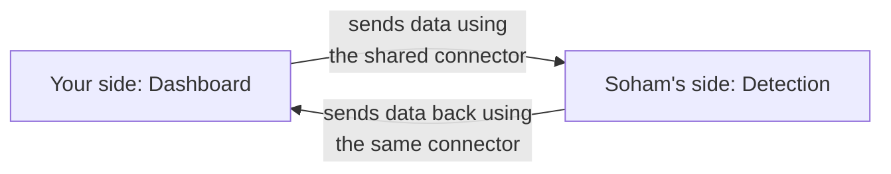

# Bastion — Your Guide

This is your version of the project plan. Same project as Soham's, just
broken into smaller pieces with one step at a time.

You can do this project. This guide just makes each step clear so you
never have to guess what's next.

---

## How this guide works

- Everything is broken into **Sessions**. One session = one sitting.
- Each session has a **checklist**. Do the boxes top to bottom.
- If a step doesn't make sense, stop and ask Soham — don't guess.
- You don't need to remember anything between sessions. Just open this
  guide and find where you left off.

---

## The big picture (read once, don't worry about details yet)

Two people are building one project. You each build a different half.
A shared file connects the two halves so you don't need to know how
Soham's half works — you just need your half to match this connector.



The connector is one file: `shared/schema.py`. You never need to change
it alone — any change to it happens together with Soham.

---

## Session 1 — Get the dataset (about 30–45 min)

**Goal:** Download the traffic data file we'll use, and just look at it.

- [ ] Open the link Soham sends you for "CICDDoS2019 dataset"
- [ ] Download it to your computer
- [ ] Open it in a notebook (Jupyter) — Soham will help you set this up
      first time
- [ ] Run one command to just look at the first few rows: `df.head()`
- [ ] Take a screenshot of what you see
- [ ] Post the screenshot in your daily log issue on GitHub, with:
      "Session 1 done: dataset downloaded and loaded"

**That's it for Session 1.** Nothing to build yet, just look at the data.

---

## Session 2 — Count what's in the data (about 30 min)

**Goal:** Find out how many rows are attacks vs. normal traffic.

- [ ] Run: `df['attack_type'].value_counts()` (or whatever the column is
      called — Soham can confirm the exact name from Session 1)
- [ ] Take a screenshot of the result
- [ ] Post it in the daily log: "Session 2 done: counted attack types"

**Stuck?** If the command gives an error, screenshot the error and post
it in the daily log — don't try to fix it alone first. Errors are normal,
not a sign you did something wrong.

---

## Session 3 — List the columns (about 30 min)

**Goal:** Write down what information the dataset has.

- [ ] Run: `df.columns` and `df.dtypes`
- [ ] Screenshot both
- [ ] Post in daily log: "Session 3 done: listed columns"

After Session 3, you and Soham will sit together (or call) to look at
`shared/schema.py` — the connector file — one time. This is the only
step that needs to happen together, not solo.

---

## Session 4 — Clean the data (small chunks, ~30 min each)

Do these one at a time, not all in one sitting:

- [ ] **4a:** Remove rows with missing values — Soham will give you the
      exact one-line command to paste
- [ ] **4b:** Remove duplicate rows — same, one command
- [ ] **4c:** Save the cleaned file — one command, then screenshot the
      confirmation
- [ ] Post in daily log after each: "Session 4a done", "4b done", etc.

---

## Session 5 — Flask skeleton (this one's bigger, plan 2 sessions)

**Goal:** A very small website that can receive data.

**Part 1 — the AI IDE prompt to use (copy this exactly):**

```
Here is the exact shared contract, do not deviate from it:
[paste shared/schema.py here]

Task: Create a very simple Flask app with ONE endpoint at /event
that accepts a DetectionEvent as JSON and just prints it to the
console. Nothing else. Keep it as short as possible.

Constraints:
- Do not add extra endpoints
- Do not add a database yet
- If anything is unclear, stop and ask instead of guessing
```

- [ ] Paste that into the AI IDE, let it build the file
- [ ] Ask Soham (or the AI IDE) to show you how to run it — usually
      `python app.py`
- [ ] Confirm it starts without an error — screenshot the terminal
- [ ] Post in daily log: "Session 5 part 1 done: Flask app runs"

**Part 2 — test it works:**

- [ ] Soham will send you a fake test event (a JSON snippet)
- [ ] Send it to your Flask app (he'll show you the exact command —
      usually one line with `curl`)
- [ ] Confirm you see it printed in your terminal
- [ ] Screenshot and post: "Session 5 part 2 done: endpoint tested"

---

## Every session, no matter what

1. Do the checklist, top to bottom, one box at a time.
2. Screenshot your result.
3. Post one line in the daily log issue: what session, what got done.
4. If something breaks or doesn't make sense — post that too, and stop.
   Soham will look at it before your next session. You're never expected
   to debug alone.

---

## Things you never have to worry about

- You don't need to memorize git commands — Soham can give you the
  exact lines to paste each time, or you can ask the AI IDE: "give me
  the exact git commands to commit and push these changes."
- You don't need to understand Soham's half of the project in detail.
  You only need your half to match `shared/schema.py`.
- You're not behind if a session takes longer than the time listed above.
  These are rough guides, not deadlines.
