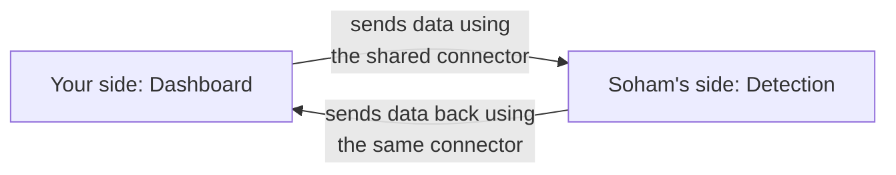

# Bastion — Your Guide

This is your version of the project plan. Same project as Soham's, just
broken into smaller pieces with one step at a time.

You can do this project. This guide just makes each step clear so you
never have to guess what's next.

---

## How this guide works

- Everything is broken into **Sessions**. One session = one sitting.
- Each session has a **checklist**. Do the boxes top to bottom.
- If a step doesn't make sense, stop and ask Soham — don't guess.
- You don't need to remember anything between sessions. Just open this
  guide and find where you left off.

---

## The big picture (read once, don't worry about details yet)

Two people are building one project. You each build a different half.
A shared file connects the two halves so you don't need to know how
Soham's half works — you just need your half to match this connector.



The connector is one file: `shared/schema.py`. You never need to change
it alone — any change to it happens together with Soham.

---

## Session 1 — Get the dataset (about 30–45 min)

**Goal:** Download the traffic data file we'll use, and just look at it.

- [ ] Open the link Soham sends you for "CICDDoS2019 dataset"
- [ ] Download it to your computer
- [ ] Open it in a notebook (Jupyter) — Soham will help you set this up
      first time
- [ ] Run one command to just look at the first few rows: `df.head()`
- [ ] Take a screenshot of what you see
- [ ] Post the screenshot in your daily log issue on GitHub, with:
      "Session 1 done: dataset downloaded and loaded"

**That's it for Session 1.** Nothing to build yet, just look at the data.

---

## Session 2 — Count what's in the data (about 30 min)

**Goal:** Find out how many rows are attacks vs. normal traffic.

- [ ] Run: `df['attack_type'].value_counts()` (or whatever the column is
      called — Soham can confirm the exact name from Session 1)
- [ ] Take a screenshot of the result
- [ ] Post it in the daily log: "Session 2 done: counted attack types"

**Stuck?** If the command gives an error, screenshot the error and post
it in the daily log — don't try to fix it alone first. Errors are normal,
not a sign you did something wrong.

---

## Session 3 — List the columns (about 30 min)

**Goal:** Write down what information the dataset has.

- [ ] Run: `df.columns` and `df.dtypes`
- [ ] Screenshot both
- [ ] Post in daily log: "Session 3 done: listed columns"

After Session 3, you and Soham will sit together (or call) to look at
`shared/schema.py` — the connector file — one time. This is the only
step that needs to happen together, not solo.

---

## Session 4 — Clean the data (small chunks, ~30 min each)

Do these one at a time, not all in one sitting:

- [ ] **4a:** Remove rows with missing values — Soham will give you the
      exact one-line command to paste
- [ ] **4b:** Remove duplicate rows — same, one command
- [ ] **4c:** Save the cleaned file — one command, then screenshot the
      confirmation
- [ ] Post in daily log after each: "Session 4a done", "4b done", etc.

---

## Session 5 — Flask skeleton (this one's bigger, plan 2 sessions)

**Goal:** A very small website that can receive data.

**Part 1 — the AI IDE prompt to use (copy this exactly):**

```
Here is the exact shared contract, do not deviate from it:
[paste shared/schema.py here]

Task: Create a very simple Flask app with ONE endpoint at /event
that accepts a DetectionEvent as JSON and just prints it to the
console. Nothing else. Keep it as short as possible.

Constraints:
- Do not add extra endpoints
- Do not add a database yet
- If anything is unclear, stop and ask instead of guessing
```

- [ ] Paste that into the AI IDE, let it build the file
- [ ] Ask Soham (or the AI IDE) to show you how to run it — usually
      `python app.py`
- [ ] Confirm it starts without an error — screenshot the terminal
- [ ] Post in daily log: "Session 5 part 1 done: Flask app runs"

**Part 2 — test it works:**

- [ ] Soham will send you a fake test event (a JSON snippet)
- [ ] Send it to your Flask app (he'll show you the exact command —
      usually one line with `curl`)
- [ ] Confirm you see it printed in your terminal
- [ ] Screenshot and post: "Session 5 part 2 done: endpoint tested"

---

## A note before Session 6 — the skeleton already exists

There's already a working version of the Flask app on GitHub, in a pull
request called **"[W2][Dashboard] Flask /event skeleton"** (#24). You don't
have to build it from nothing. You can:

- **Read it** to see what a finished Session 5 looks like, and
- **Run it** to check your own against it.

To run it (Soham can paste you the exact commands the first time):

```bash
cd dashboard/backend
python -m venv .venv && source .venv/bin/activate
pip install -r requirements.txt
python app.py
```

Then in a second terminal: `python send_test_event.py` — you should see
`202` and the event printed by the server. That's the whole Week 2 goal,
already proven. From here, each session adds one small thing on top.

---

## Session 6 — Make the data columns match the connector (~30 min)

**Goal:** Line up your cleaned dataset's columns with the shared feature list
so both halves speak the same language.

- [ ] Open `detection/features/extract.py` and find the list called
      `FEATURE_COLUMNS` (near the top). That's the agreed set of columns.
- [ ] In your notebook, print your cleaned dataset's columns: `df.columns`
- [ ] Make a simple two-column note: "their column name" / "my column name",
      matching them up by meaning
- [ ] Don't rename anything yet — just the note. Bring it to the Week 3 sync
      with Soham (issue #9), that's where you reconcile them together
- [ ] Post in daily log: "Session 6 done: mapped my columns to FEATURE_COLUMNS"

**Why:** Week 3's sync is literally "compare the two column lists side by
side." This note is your half of that.

---

## Session 7 — Save one combined data file (~30 min)

**Goal:** Produce one CSV that uses the shared column names.

- [ ] Rename your columns to match the shared ones (Soham gives you the exact
      one-line `df.rename(...)` after Session 6)
- [ ] Keep only the shared columns + the label column
- [ ] Save it: `df.to_csv("dashboard/data/combined.csv", index=False)`
- [ ] Screenshot the first few rows (`df.head()`)
- [ ] Post in daily log: "Session 7 done: saved combined.csv"

**Stuck?** Screenshot the error and post it. A wrong column name is the most
common hiccup here — it's a one-word fix, not a sign anything's broken.

---

## Session 8 — Show a list of events on a page (~45 min, your first UI)

**Goal:** A plain web page that lists the events the backend has received.

**AI IDE prompt to use (copy this exactly):**

```
Here is the exact shared contract, do not deviate from it:
[paste shared/schema.py here]

The Flask app (dashboard/backend/app.py) already has a GET /events endpoint
that returns {"count": N, "events": [...]}.

Task: Add ONE new page at the route "/" that fetches /events and shows the
events in a simple HTML table: columns for timestamp, src_ip, attack_type,
confidence, action_taken. Plain HTML, no framework.

Constraints:
- Do not change app.py's existing /event or /events endpoints
- Do not add a database
- If anything is unclear, stop and ask instead of guessing
```

- [ ] Paste it in, let it build the page
- [ ] Run the app, send a couple of test events (`send_test_event.py`)
- [ ] Open `http://127.0.0.1:5000/` in a browser — you should see the table
- [ ] Screenshot the page
- [ ] Post in daily log: "Session 8 done: events show in a table"

---

## Session 9 — Add two summary numbers (~30 min)

**Goal:** Show "total events" and "number of flagged (non-benign) IPs" at the
top of the page.

- [ ] Ask the AI IDE: "On the same page, above the table, show two numbers:
      total events, and how many events have attack_type that is not benign.
      Don't change anything else."
- [ ] Run it, send a few test events, confirm the numbers look right
- [ ] Screenshot and post: "Session 9 done: summary counts added"

**That maps to issue #11** (traffic volume + flagged IP list). You're building
it one number at a time.

---

## Session 10 — Color the rows by attack type (~30 min)

**Goal:** Make attacks easy to spot at a glance.

- [ ] Ask the AI IDE: "Color each table row by attack_type: benign = normal,
      syn_flood / udp_flood / slowloris each a different highlight color. Also
      show confidence as a percentage. Change nothing else."
- [ ] Run, send test events of different types (Soham can give you a few)
- [ ] Screenshot the colored table
- [ ] Post in daily log: "Session 10 done: rows colored by attack type"

---

## Session 11 — Make the page refresh itself (~30 min)

**Goal:** New events show up without you reloading the page.

- [ ] Ask the AI IDE: "Make the page re-fetch /events every 2 seconds and
      update the table automatically (simple polling with fetch + setInterval).
      Don't change the backend."
- [ ] Run the app, then run the detection pipeline Soham points you to
      (`python detection/pipeline.py --url http://127.0.0.1:5000`) and watch
      rows appear on their own
- [ ] Screenshot (or screen-record) the page updating
- [ ] Post in daily log: "Session 11 done: page auto-updates"

**This is issue #14** — the first time your dashboard shows a live attack.
Big milestone. Expect it to feel cool.

---

## Session 12 — A separate "blocked IPs" view (~30 min)

**Goal:** A small list of just the events where `action_taken` is `blocked`.

- [ ] Ask the AI IDE: "Add a second small table below the first, listing only
      events where action_taken == 'blocked', showing src_ip and timestamp.
      Change nothing else."
- [ ] Run and test (blocked events arrive once Soham's mitigation is on in
      Week 6 — until then, send a hand-crafted blocked event to check the view)
- [ ] Screenshot and post: "Session 12 done: blocked-IP view added"

**Issue #17.**

---

## Session 13 — A simple results chart (~45 min, in a notebook)

**Goal:** One chart showing how well the model does per attack type. Soham
pairs with you on this one — it uses his model's output.

- [ ] Soham gives you a small results file (true vs. predicted labels)
- [ ] In a notebook, ask the AI IDE: "Load this CSV of true and predicted
      labels and draw a confusion matrix with matplotlib. Label the axes."
- [ ] Run it, screenshot the chart
- [ ] Post in daily log: "Session 13 done: confusion matrix chart"

**Part of issue #17** (evaluation notebook). One chart is plenty for now.

---

## Session 14 — Final tidy-up (~45 min, spread out)

**Goal:** Make it presentable for the viva. Small polish, one at a time.

- [ ] **14a:** Add a title and a one-line description at the top of the page
- [ ] **14b:** Draw a simple architecture diagram (boxes: attacker → monitor →
      detection → dashboard). Hand-drawn and photographed is totally fine
- [ ] **14c:** Read through your daily-log posts and copy the highlights into
      a short "what the dashboard does" paragraph for the report
- [ ] Post after each: "Session 14a done", "14b done", "14c done"

**Issue #20.** After this, you and Soham do the final run-through together
(Week 8).

---

## Every session, no matter what

1. Do the checklist, top to bottom, one box at a time.
2. Screenshot your result.
3. Post one line in the daily log issue: what session, what got done.
4. If something breaks or doesn't make sense — post that too, and stop.
   Soham will look at it before your next session. You're never expected
   to debug alone.

---

## Things you never have to worry about

- You don't need to memorize git commands — Soham can give you the
  exact lines to paste each time, or you can ask the AI IDE: "give me
  the exact git commands to commit and push these changes."
- You don't need to understand Soham's half of the project in detail.
  You only need your half to match `shared/schema.py`.
- You're not behind if a session takes longer than the time listed above.
  These are rough guides, not deadlines.
